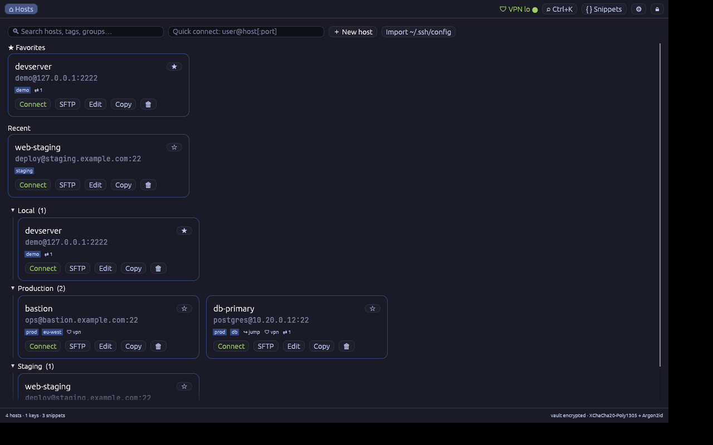
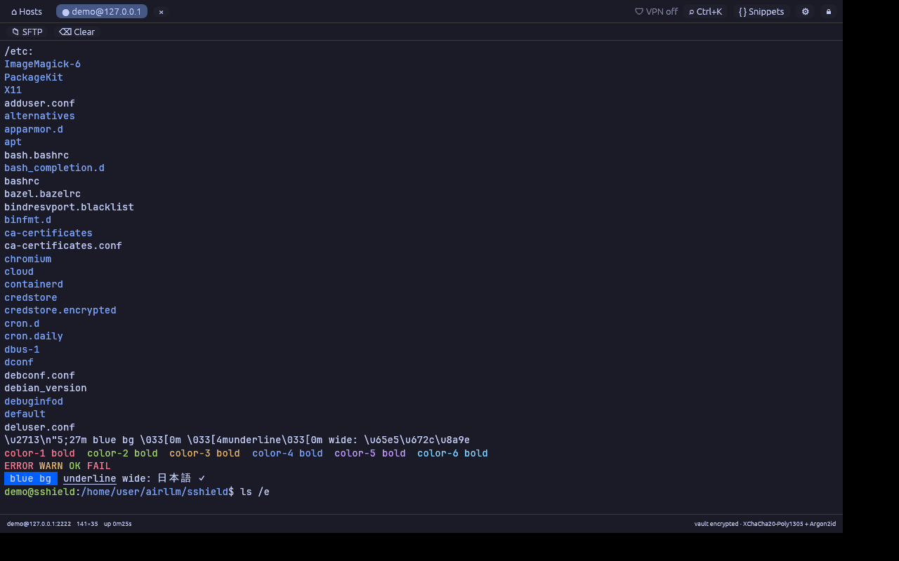
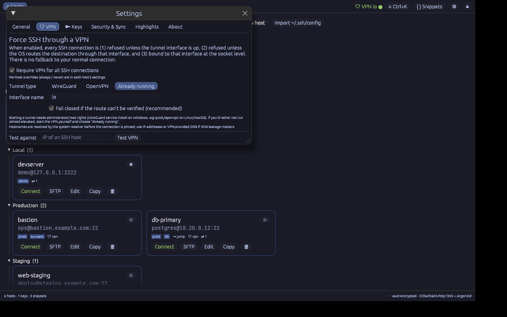
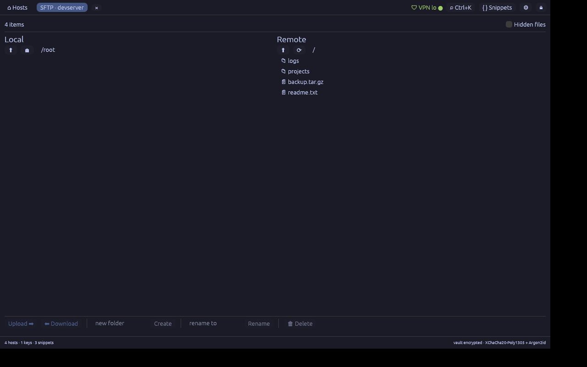

# sshield

A fast, native, **completely free** SSH client for Windows (first-class), Linux and macOS —
built in Rust, one ~15 MB executable, no Electron, no account, no telemetry, no paywall.

It aims at everything Termius locks behind a subscription (SFTP, snippets, jump hosts,
port forwarding, multi-session broadcast, autocomplete, encrypted vault + sync, themes…)
and adds one thing it doesn't have: **force all SSH traffic through WireGuard or OpenVPN**.



| Terminal | VPN enforcement | SFTP |
|---|---|---|
|  |  |  |

## Highlights

| | |
|---|---|
| **VPN enforcement** | Per-app or per-host policy: SSH is refused unless a WireGuard / OpenVPN tunnel is up, the OS routes the destination through it, and the socket is pinned to the tunnel interface. Fails closed. See [below](#force-ssh-through-a-vpn). |
| **Terminal** | Full VT/xterm emulation (256 + true colour, alt-screen, bracketed paste, wide/CJK chars), 10 000-line scrollback (configurable), selection + copy-on-select, 10 built-in themes, custom font file, keyword highlighting. |
| **Hosts** | Groups, tags, favourites, recents, search, quick-connect (`user@host:port`), Ctrl+K command palette, import from `~/.ssh/config`. |
| **Auth** | Password, saved keys (Ed25519 generator built in; OpenSSH / PEM / PuTTY `.ppk` import), key files, keyboard-interactive (2FA / OTP prompts). |
| **Jump hosts** | Unlimited `ProxyJump` chains, cycle-checked. Each hop's host key is verified. |
| **Port forwarding** | Local `-L`, remote `-R`, dynamic SOCKS5 `-D`; start automatically per host; live connection counters; stop with one click. |
| **SFTP** | Dual-pane browser (local ⇄ remote), upload/download with progress, mkdir, rename, recursive delete. Reuses the terminal's connection — no second login. |
| **Snippets & multi-exec** | Saved commands; run on the active terminal or on **all** open terminals. **Broadcast** mode mirrors your typing to every session. |
| **Autocomplete** | Ghost-text suggestions from your command history and snippets (→ to accept). |
| **Security** | Whole library (hosts, usernames, keys, passwords) is sealed with **Argon2id (64 MiB, t=3) + XChaCha20-Poly1305**; header bound as AAD; atomic writes; strict TOFU host-key checking that never silently overwrites a changed key. |
| **Sync, no server** | Point "Sync folder" at Dropbox/OneDrive/Syncthing/NAS; the encrypted vault is mirrored there on every change. |
| **Session logs** | Optional raw session logging to files. |

## Force SSH through a VPN

*Settings → VPN* (global) and *Host → VPN* (per-host: follow global / always / never).

1. **Tunnel lifecycle** – choose *WireGuard* (`wg-quick up` on Linux/macOS, `wireguard.exe /installtunnelservice` on Windows),
   *OpenVPN* (`openvpn --config …`, supervised child process) or *Already running* (you manage the VPN; sshield only enforces).
   With "start automatically", sshield brings the tunnel up on demand and waits for the interface.
2. **Route verification** – before connecting, the OS is asked which interface would carry traffic to the destination
   (`ip route get` / `/proc/net/route` on Linux, `route -n get` on macOS, `Find-NetRoute` on Windows).
   If it isn't the tunnel interface (e.g. split-tunnel that doesn't cover the host) the connection is **refused**
   with an explanation — never leaked.
3. **Socket pinning** – the TCP socket is bound to the tunnel interface and its address
   (`SO_BINDTODEVICE` on Linux, `IP_UNICAST_IF`/`IPV6_UNICAST_IF` on Windows, `IP_BOUND_IF` on macOS).

If anything can't be verified, the connection fails (configurable "fail closed" is on by default).
Jump-host chains are covered: only the first TCP hop touches the network and it is pinned; later hops ride inside it.

Notes / limits (please read):
* Starting a tunnel needs administrator / root. If you'd rather not run sshield elevated, start the VPN yourself and pick *Already running*.
* Hostnames are resolved by the system resolver *before* pinning. Use IP addresses or a VPN-provided resolver if DNS metadata leakage matters.
* This governs **sshield's** SSH traffic. It is not a system-wide kill switch.

## Build

```bash
cd sshield
cargo build --release -p sshield        # target/release/sshield(.exe)
cargo test --workspace                  # 35 tests, incl. an in-process SSH/SFTP server
```

Linux needs the usual windowing libs (`libxkbcommon`, `libwayland`, `libx11`, OpenGL). Windows needs only the Rust toolchain (MSVC or GNU).

Try it without a server:

```bash
cargo run -p sshield-core --example devserver     # 127.0.0.1:2222, demo/demo, real bash (Unix)
cargo run -p sshield                              # then: quick-connect  demo@127.0.0.1:2222
```

## Keyboard

| | |
|---|---|
| `Ctrl+K` | command palette (hosts, snippets) |
| `Alt+1…9` | switch tab |
| `Ctrl+Shift+W` | close tab |
| `Ctrl+C` | copy if text is selected, otherwise sends `^C` |
| `Ctrl+V` | paste (bracketed when the app asks for it) |
| `Shift+PgUp/PgDn`, wheel | scrollback |
| `→` at end of line | accept autocomplete suggestion |

## Honest status

Tested: vault crypto, host-key TOFU (new/changed/rejected), password / prompt auth, shell, exec, `-L`/`-R`/`-D`,
jump chain, SFTP round trip (300 KB, byte-identical), VPN fail-closed + pinned socket (using the loopback interface
as the "tunnel"), terminal emulation + input encoding, and the GUI end-to-end under Xvfb against a real `bash`.

Cross-checked for Windows with `cargo check --target x86_64-pc-windows-gnu` (a CI workflow for Windows/Linux/macOS is included but has not run yet), but the Windows-specific paths
(`IP_UNICAST_IF`, PowerShell route lookup, `wireguard.exe` service install) have **not been run against a real
Windows VPN yet** — please try them and report. Likewise real WireGuard/OpenVPN tunnels were not available in the
development sandbox; the lifecycle code paths are unit-tested for command construction, not executed.

Not implemented (yet): SSH agent / agent forwarding, split panes, host-certificates, X11 forwarding, mouse reporting
for TUI apps, multi-device *merge* sync (the sync folder is a one-way mirror), team vaults, mobile apps, biometrics/OS-keychain unlock.

## Layout

```
crates/sshield-core   vault, model, vpn, ssh (+jump), forward, sftp, ssh_config import   (no UI)
crates/sshield        egui app: terminal widget, SFTP view, themes, dialogs
```
